# ONI pipeline map

What the application does end to end, drawn from the code as it stands on branch `canvas` at `8cf90530` (the Portra 800 merge, task 2500, committed; the working tree is clean). Paths are relative to `crates/`. Every box is named as the code names it. When a label and a line in the code disagree, the code is right.

Contents:

1. The big picture
2. The render pipeline per conversion mode
3. The two faces: Pro and Scanner
4. Measurement flows
5. The library side
6. The GPU/CPU split
7. Things found while mapping
8. Glossary

---

## 1. The big picture

### 1a. Files to pixels to screen

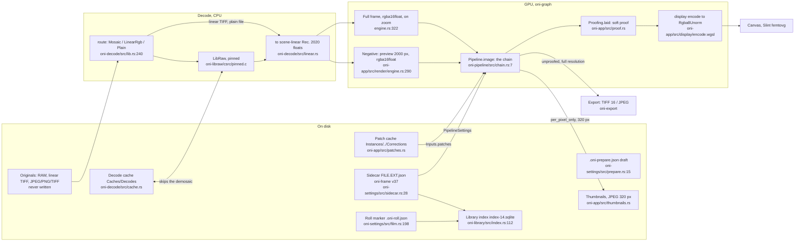

A file is sorted by its bytes (`route`) onto one of three branches. A RAW goes through LibRaw with every automatic knob pinned. The editor reads it at LibRaw's half size unless Settings asks for the whole decode (`FULL_DECODE`, `oni-app/src/render/decode.rs:7`). A RAW is balanced on 5000 K / tint 0, but a slide RAW on 5500 K (`oni-decode/src/neutral.rs:4`). The decoded floats go to the GPU in half precision. Each 2000 px preview, and each halving of it, is held in `rgba16float`; every stage writes `rgba32float`. Every picture the editor shows goes through the same `Pipeline.image`, then the proof and the display kernel, which is the only 8-bit step. Export renders the same chain at full resolution without the proof, and `oni_export::write` converts into the file's space. Thumbnails render the preview with every neighbourhood stage off (`oni-app/src/app/workers.rs:159`). A frame that is not yet converted shows its RAW's embedded preview instead (`oni-app/src/scans.rs`).

### 1b. Where the store, history and measures sit

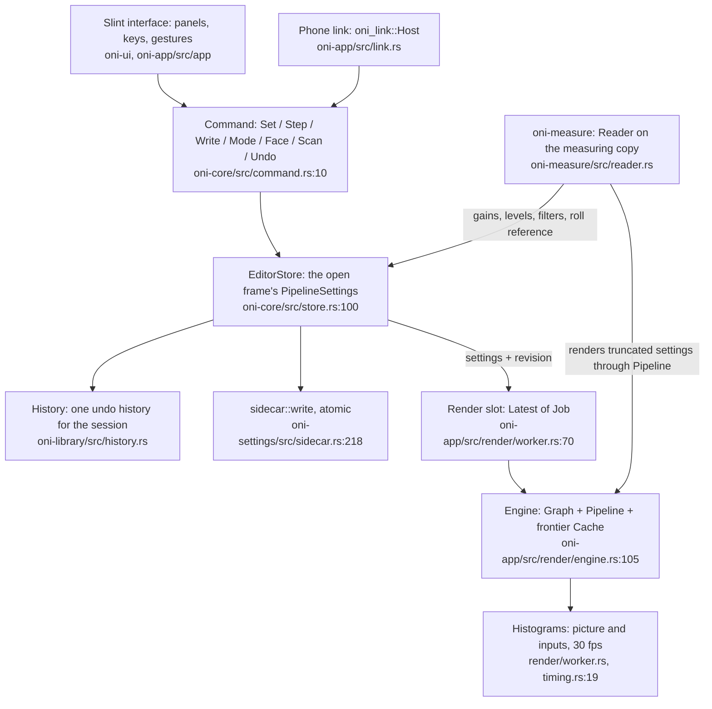

Every hand, key and phone press is a `Command` on the one `EditorStore`. A notch is one write. The step is recorded in the session's single `History`, which covers every frame a gesture wrote, and the sidecar is written atomically. The store passes the settings to the render slot. Measurements (`oni-measure`) render through the same pipeline, using settings truncated before a stage. They only hand values back to the store as a step, so an automatic action writes only what it shows.

---

## 2. The render pipeline per conversion mode

### 2a. The whole chain, in the order the code runs it

`Pipeline::chain` (`oni-pipeline/src/chain.rs:43`) drives the order. Boxes with dashed edges are skipped for some modes; diagram 2b says which.

```mermaid
flowchart TD
  IN["Source: preview, a halving or the full frame<br/>Lanczos to the request's scale, chain.rs:29"]
  subgraph Healed["healed, lib.rs:137, in the scan's own frame"]
    P["patched: dust patches through feathered strokes<br/>lib.rs:197, healing.rs"]
    CE["exposure minus captureStops<br/>stages/per_pixel.rs, film modes"]
    FF["flat_field: Valoi Easy35 or custom mask<br/>lib.rs:170, flat_field.rs"]
    OV["optical_vignette: lens vignetting<br/>Digital only"]
  end
  subgraph Framed["framed, lib.rs:124"]
    G0["Stage 0 geometry: turns, mirrors, angle, crop, lens warp<br/>geometry.rs:132"]
    RC["reciprocal: a positive read as a negative<br/>invertedSource, conversion.rs:19"]
  end
  WM["color_matrix: White, chosen white over the decode's anchor<br/>conversion.rs:59, Digital only"]
  HA["halation: highlight glow, blurred<br/>halation.rs:26, Digital only"]
  GR["grain: a pass of its own<br/>grain.rs, Digital only"]
  VN["virtual_negative: scene exposed, developed and scanned<br/>lib.rs:155, Digital on a virtual film"]
  S47["stage47: inversion, gains, windows, decompression, dye separation, print<br/>conversion.rs:73, kernel/stage47.rs:180"]
  MACH{"Scanner face?"}
  OF["oni_finish: encode, look cube, TEMP warmth, scanner_output<br/>lib.rs:223"]
  CV["curves: Curves and a digital photo's Levels, baked tables<br/>lib.rs:245, finishing.rs:17"]
  P1["one pass: Lighting for Digital, Colour Mixer, points saturation, Saturation Curve, Vignette<br/>lib.rs:282-292"]
  DN["detail: chroma denoise, plus sharpen when Texture rests<br/>lib.rs:323, skipped on a contact sheet"]
  TX["texture: three blurs, three kernels<br/>lib.rs:331"]
  SH["detail: sharpen, when Texture is on"]
  P2["one pass: Chrome (secretSauce), luma_only, output_clip<br/>lib.rs:298-309"]
  OUT["picture, linear Rec. 2020, rgba32float"]
  IN --> P --> CE --> FF --> G0
  P -.-> OV -.-> G0
  G0 --> RC --> WM --> HA --> GR --> VN --> S47 --> MACH
  MACH -->|"no, Pro"| CV
  MACH -->|"yes"| OF --> CV
  CV --> P1 --> DN --> TX --> SH --> P2 --> OUT
```

Notes the diagram cannot carry:

- `healed` runs before stage 0, so a patch, the capture exposure and the flat-field never move with the crop (`lib.rs:133-136`).
- On a Pro film frame, Lighting is the print inside `stage47`. On a Pro digital photo, `stage47` prints at rest (`unlit_print`) and Lighting runs as a separate `print` kernel. That kernel sits after the curves' tables when they exist, and otherwise in the same pass as `stage47` (`chain.rs:84-86`, `conversion.rs:79`).
- A digital photo on the Scanner face differs again. Its Levels are baked in front of the machine's print, then the machine prints, then the face's own curves run after the look (`chain.rs:75-82`).
- A measurement (`Request.measuring`) skips halation and grain, the output clip and a sheet's ground (`chain.rs:62`, `lib.rs:303`).

### 2b. Which stage runs in which mode

The rule each stage follows comes from `ConversionMode::is_film` (everything but Digital), `reads_positive` (Positive and Digital) and `PipelineSettings::filmed` (a Digital frame with a `virtualFilm`), in `oni-settings/src/modes.rs:43-60` and `settings.rs:242`.

| Stage | Negative | Positive (slide) | Monochrome | Digital | Digital on a virtual film |
|---|---|---|---|---|---|
| Dust patches | yes | yes | yes | yes | yes |
| Capture exposure, flat-field | yes | yes | yes | no | no |
| Optical vignetting (lens) | no | no | no | yes | yes |
| Stage 0 geometry | yes | yes | yes | yes, with the lens warp | yes, with the lens warp |
| Reciprocal (invertedSource) | if set | cleared on leaving Negative | cleared | no | no |
| White matrix | no | no | no | if White differs from the anchor | if White differs from the anchor, before the film |
| Halation, grain | no (owner's call, `chain.rs:61`) | no | no | if set | if set, before the film |
| Virtual negative | no | no | no | no | yes |
| Stage 4-5 inversion | inverted | positive axis | inverted, graduated window | positive axis, neutral windows | inverted (`read_as` = Negative) |
| Gains | the roll's | the slide's | the roll's | none on Pro, the keys on Scanner | the film's `stops`, plus the keys on Scanner |
| Chroma decompression | dose | full dose, no film share | full dose | none | none |
| Dye separation | dose | 0 | identity matrix | 0 | 0 |
| Print in stage 6-7 | Lighting, filters, Hunt, Color Density | same | no Hunt, no channel tone | at rest | at rest |
| Lighting as a separate print kernel | no | no | no | yes | yes |
| Picture Levels in the curves | no | no | no | yes | yes |
| Points saturation | yes | yes (mirrored white) | no | yes | yes |
| luma_only | no | no | yes | if Black and White | if Black and White |

### 2c. The virtual film: the scan back into the negative path

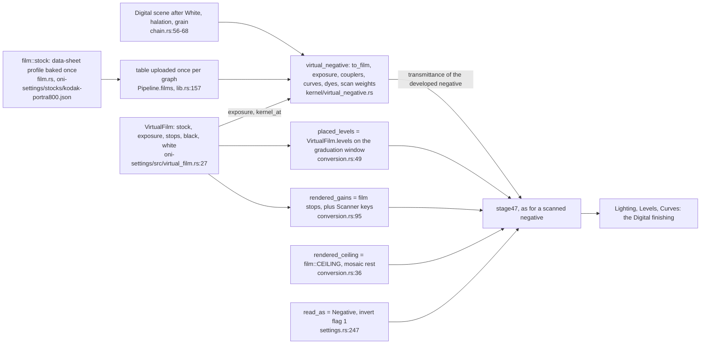

The virtual film is a Digital-mode feature only (`filmed()`). The scene is exposed on the stock's spectral sensitivities and developed on its curves with DIR couplers. The result is read by a colorimetric camera on a light table, so the kernel outputs a scan of a negative. That scan re-enters the chain at `stage47` like any negative. The film's own reference stands where a roll's measure would: it supplies the gains, each channel's black and white on the graduation window, and a mosaic ceiling. The frame keeps its Digital finishing: Lighting as a separate print, Picture Levels in the curves, and no dye separation or decompression. `virtualFilm` travels with the Roll Settings family (`settings/roll_settings.rs:34`). Presets exclude it (`oni-core/src/parameters/excluded.rs`).

### 2d. Where a slider notch restarts

The canvas renders through `Cache::frontier()` (`oni-graph/src/graph/cache.rs:8`). Each node is keyed by a hash of its source and every stage above it. A render keeps only the unchanged results that a changed node reads, then starts from the deepest one still current. The passes below are the nodes a notch can restart from.

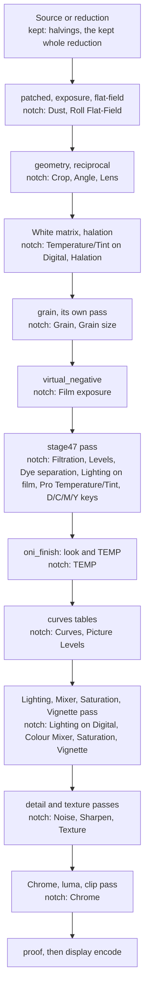

A Chrome notch reruns only the last pass, then the proof and the display kernel. A Lighting notch on a negative restarts at `stage47`, reading the grained scene the cache kept. Grain and halation lie before the print, but their tone curve is computed from `stage47` with unit gains (`grain.rs:33`). So a print notch does not reach them, and a key press on the Scanner face does not either. The `laid` passes (`stages/fused.rs:33`) run consecutive per-pixel kernels as one read and one write. A notch on any kernel inside a pass reruns the whole pass.

---

## 3. The two faces: Pro and Scanner

### 3a. How the face picks the settings the chain runs on

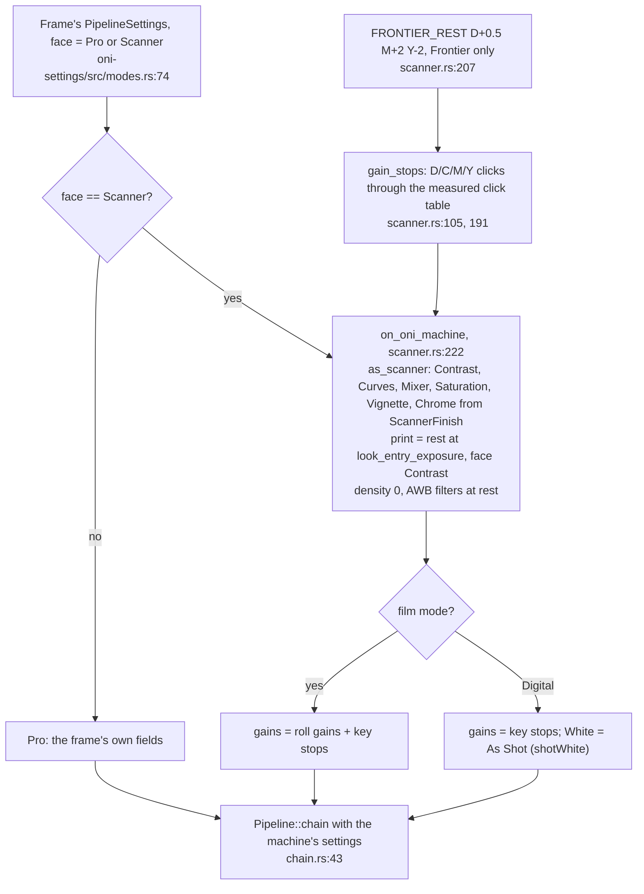

### 3b. The machines after stage 4-7

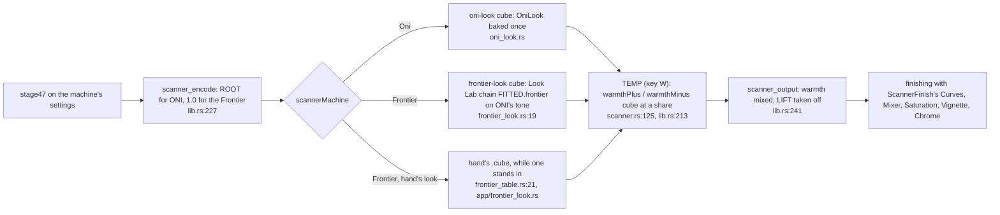

### 3c. Where each face's controls enter the chain

| Control (UI name) | Face | Field | Where it acts |
|---|---|---|---|
| Filtration (Roll tab) | both | `gains` | stage47 gains |
| Per-Channel Levels, Dye Separation, Highlight Detail, Flat-Field | both (Roll tab) | `levels`, `separation`, `densityCeiling`, `flatField` | stage47, healed |
| Temperature / Tint (Colour, film) | Pro | `print` filters via AWB / `balanceFilters` | stage47 print `own_stops` |
| Temperature / Tint (Colour, Digital) | Pro | `white` | color_matrix before halation |
| Lighting: Exposure, Contrast, Shadows, Highlights, points | Pro | `print` | stage47 print (film), `print` kernel (Digital) |
| More Color Settings: channel contrast/mid | Pro | `print.channel_*` | stage47 print |
| D, C, M, Y (Density, Colour) | Scanner | `scanner.d/c/m/y` | gains, through `gain_stops` |
| Temperature (Look, key TEMP) | Scanner | `scanner.w` | warmth cube after the look |
| Machine: ONI / Frontier | Scanner | `scannerMachine` | look cube choice, Frontier rest |
| Contrast, Vignette, Chrome (Effects keys) | Scanner | `scannerFinish.*` | machine print contrast, vignette, sauce |
| Curves, Colour Mixer, Saturation Curve | both, each face its own | `manualCurves`... or `scannerFinish.*` | finishing |
| Chrome (Effects) | Pro | `secretSauce` | last pass |
| Film, Film exposure, Black and White, Levels | both (Digital) | `virtualFilm`, `blackAndWhite`, `pictureLevels` | virtual_negative, luma_only, curves |
| Grain, Halation (Film Effects) | both (Digital) | `grain`, `halation` | before stage47 |

Labels are from `oni-ui/ui/panel/color_tab.slint` and `roll_tab.slint`. The keypad sends the same `Scan` commands the phone does (`oni-app/src/app/lab.rs:1`, `oni-core/src/command.rs:60`).

---

## 4. Measurement flows

Every measurement goes through `oni-measure`. Its `Reader` renders a measuring copy: a 2000 px decode reduced to `MEASURE_SIDE` 1400 (`oni-measure/src/reader.rs:18`). It reads through the pipeline with settings cut before a stage, `truncated(Stage::…)` (`oni-measure/src/truncate.rs:24`), and then reads blocks inside the measure window.

### 4a. Prepare the Roll

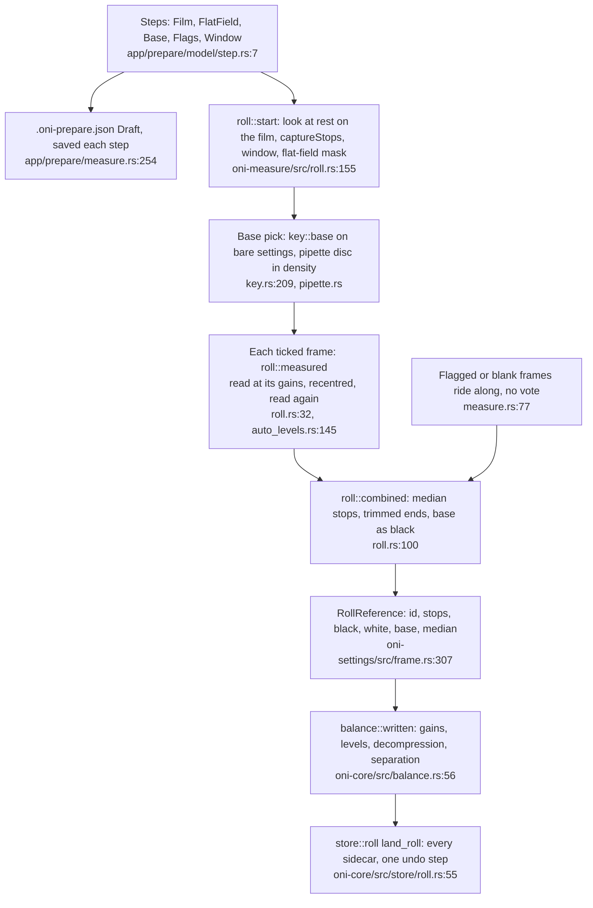

Prepare measures the frames uncropped, with the crop at UNIT and the angle at 0 (`app/prepare.rs:309`). It reads through `Stage::Levels`, which is the film after the gains and before the windows, with the print bypassed. The only pick is the Base pick: there is no "dark pick" step, field or function. Slides take a different path. Their picked white turns into gains (`slide_gains::white`) and their levels are set to rest, with no roll reference (`app/prepare/slides.rs`). A Digital roll records only the film as Digital (`store/roll.rs:111`).

### 4b. Auto White Balance and the levels

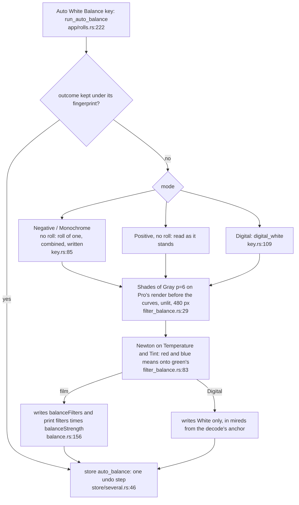

A Monochrome frame gets zero filters. No path in the app calls the "Auto levels" functions (`oni_measure::key::levels`, `placed`, `ends`, `key.rs:36-64`); only tests do. Levels and gains are written only by Prepare the Roll, or by Auto White Balance acting as a roll of one on a negative with no roll.

### 4c. Auto De-dust and healing

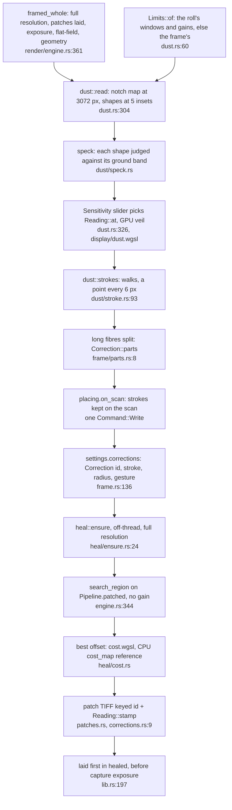

Detection reads the framed picture, which is cropped and has its gains applied. The strokes are then mapped back onto the scan, so a patch is searched and laid on the bare decoded scan. That is why no framing moves a patch and no gain slider re-heals one. The patch cache lives under the instance's caches folder and is purged at quit (`main.rs:237`).

### 4d. The flat-field

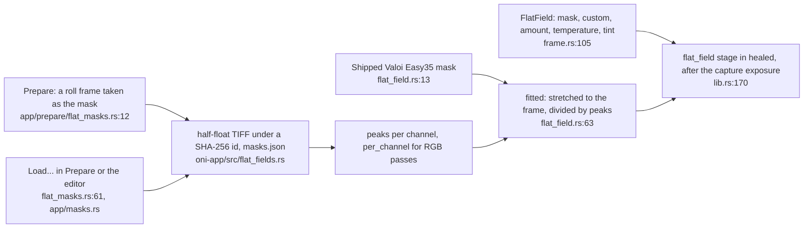

The flat-field applies to film modes only and is kept in every measurement (`truncate.rs:26`). If a frame's custom mask file is gone, the stage is left out (`lib.rs:186`).

### 4e. What the pipette and the histograms read

| Reader | What it reads | Where |
|---|---|---|
| Base pick (the only pipette) | the bare frame before Levels, a disc mean in density | `oni-measure/src/pipette.rs`, `key.rs:209` |
| Picture histogram | the proofed picture at 1024 px, linear Rec. 2020, GPU-counted at 30 fps | `render/engine/view.rs:147`, `display/histogram.wgsl` |
| Levels / curves input histograms | what enters the levels (`Stage::Levels`, or `PictureLevels` for Digital) and the curves, on the measuring copy; at 0.35 scale while held | `render/engine/inputs.rs`, `render/worker.rs:67` |
| Prepare's roll histogram | frames' counts moved to the roll's gains | `roll.rs:52` |

---

## 5. The library side

### 5a. Archive, rolls, projects and the gallery

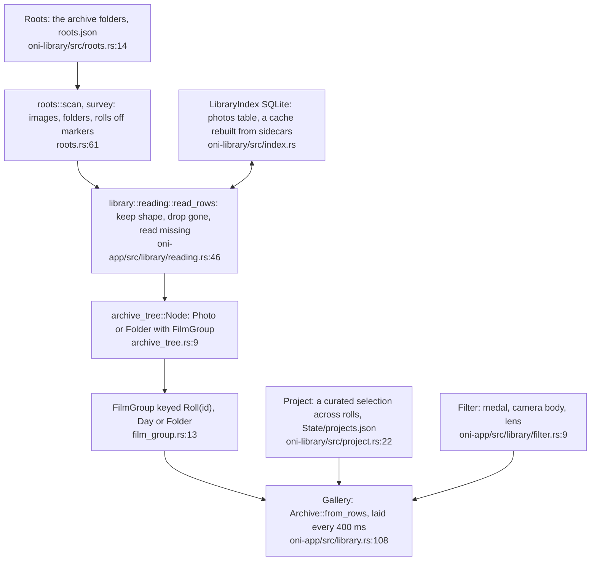

A folder becomes a roll once its `.oni-roll.json` marker names a `Film` (stock, shot date, camera body, lens). A frame's sidecar can also carry `film` and a `rollReference`, which ties it to the frames measured with it (`oni-library/src/roll_membership.rs`). The gallery filters on three things only: medal (None, Bronze, Silver, Gold), body and lens. A frame's body and lens come first from its EXIF line, then from the folder marker, then from the sidecar's film (`index.rs:66-79`).

### 5b. Gear, the Kit and export

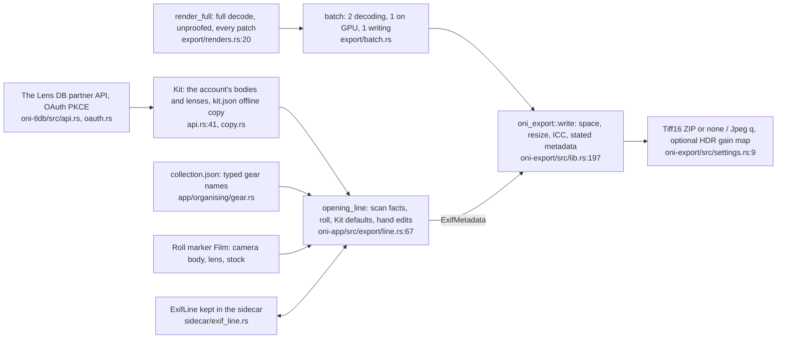

There are only two export formats, `Tiff16` and `Jpeg`; there is no DNG export. The spaces are sRGB, Display P3, Adobe RGB, ProPhoto (which forces TIFF 16) or a custom profile. The export writes only the metadata a hand stated: Make, Model, Artist, Copyright, ImageDescription (the film), LensModel, LensMake, LensSpecification, ISO and dates (`oni-export/src/metadata.rs:36`).

### 5c. What presets, paste and roll gestures carry

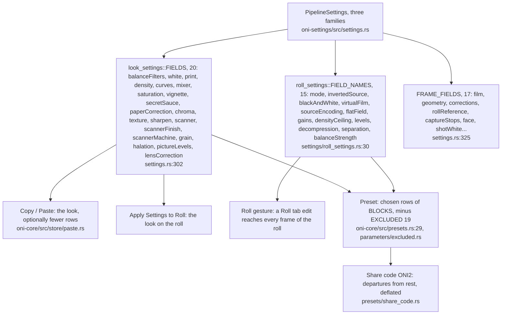

Pasting onto a frame of another roll asks first (`paste.rs:72`). Framing is copied separately (`copy_framing`). A preset never carries geometry, mode, invertedSource, blackAndWhite, virtualFilm, film, corrections, rollReference, captureStops, rgbPasses or the other excluded rows; each exclusion has its reason written in `excluded.rs`.

### 5d. The phone link

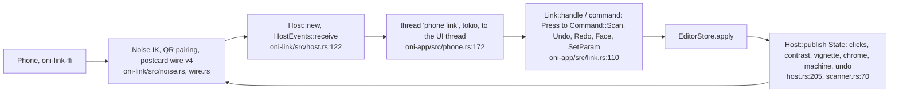

The phone link is off in shipped builds (`READY = false`, `oni-app/src/phone.rs:16`) and turns on only with `ONI_PHONE=1`. The desktop app does not use LocalSend (`oni-localsend`); only `oni-link-ffi` and the demo host do.

---

## 6. The GPU/CPU split

### 6a. Kernels and their references

Every pipeline kernel is a WGSL body in `oni-render/src/wgsl/` with a scalar CPU reference beside it in `oni-render/src/kernel/<name>.rs`, gathered in `oni-render/src/cpu.rs`. They are wrapped as graph stages in `oni-pipeline/src/stages/`.

| Chain stage | WGSL | CPU reference | Graph stage |
|---|---|---|---|
| Dust stroke mask, patch blend | `stroke_mask.wgsl`, `blend_with_mask.wgsl` | `kernel/stroke_mask.rs`, `kernel/compositing.rs` | `stages/stroke.rs`, `stages/patch.rs` |
| Capture exposure | `exposure_adjust.wgsl` | `kernel/exposure_adjust.rs` | `exposure` |
| Flat-field | `flat_field.wgsl` | `kernel/flat_field.rs` | `flat_field` |
| Optical vignetting, Vignette | `vignette.wgsl` | `kernel/vignette.rs` | `optical_vignette`, `vignette` |
| Stage 0: turns, angle, lens warp | `orient.wgsl`, `affine.wgsl`, `warp.wgsl` | `kernel/orient.rs`, `affine.rs`, `warp.rs` | `stages/resampling.rs` |
| Reciprocal | `reciprocal.wgsl` | `kernel/reciprocal.rs` | `reciprocal` |
| White, luma_only | `color_matrix.wgsl` | `kernel/color_matrix.rs` | `color_matrix`, `luma_only` |
| Halation | `halation_source.wgsl`, `halation.wgsl` | `kernel/halation.rs` | `halation` |
| Grain | `grain.wgsl` | `kernel/grain.rs` | `grain` |
| Virtual negative | `virtual_negative.wgsl` | `kernel/virtual_negative.rs` | `virtual_negative` |
| Stage 4-7, Digital Lighting | `stage47.wgsl` (`stage47_px`, `print_px`) | `kernel/stage47.rs` | `stage47`, `print` |
| Scanner encode, output | `scanner_encode.wgsl`, `scanner_output.wgsl` | `kernel/scanner.rs` | `scanner_encode`, `scanner_output` |
| Look cubes, warmth | `color_cube.wgsl` | `kernel/color_cube.rs` | `color_cube` |
| Curves | `curves.wgsl` | `kernel/curves.rs` | `curves` |
| Colour Mixer | `spectrogram.wgsl` | `kernel/spectrogram.rs` | `spectrogram` |
| Saturation, points, Chrome | `saturation_curve.wgsl` | `kernel/saturation_curve.rs` | `saturation` |
| Denoise, sharpen | `detail_rows.wgsl`, `detail_columns.wgsl`, `detail_taps.wgsl` | `kernel/detail.rs` | `DetailRows`, `DetailColumns` |
| Texture | `texture.wgsl`, `texture_math.wgsl` | `kernel/texture.rs` | `texture` |
| Blurs | `gaussian.wgsl` | `kernel/gaussian.rs` | `blurred_of` |
| Output clip | `output_clip.wgsl` | `kernel/output_clip.rs` | `output_clip` |

Outside `oni-render`:

- Lanczos and Crop are graph built-ins (`oni-graph/src/stages.rs`), with their references in `oni-graph/src/cpu.rs`.
- The display encode, the picture histogram and the dust veil are app kernels (`oni-app/src/display/*.wgsl`), with references in `display/reference.rs` and `display/dust.rs`.
- The heal search cost runs on the GPU (`oni-app/src/heal/cost.wgsl`), with `cost_map` as its CPU reference and fallback.

These steps run on the CPU only:

- the decode (LibRaw, linear conversion);
- every measurement once its render has been read back (blocks, tails, Shades of Gray, dust shapes, strokes);
- baking the patches and the tone field;
- baking the look cubes, the virtual film's table and the curve LUTs;
- encoding the export files.

### 6b. Textures, formats and the render slot

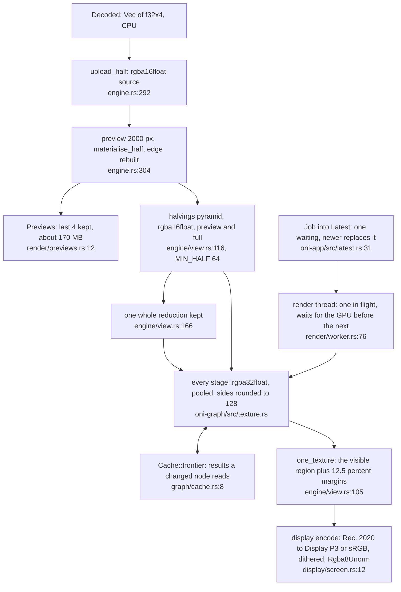

Under a moving hand, a view renders at most `GESTURE_PIXELS` (4 Mpx) and is shown stretched. The sharp render follows once the hand rests (`engine/view.rs:194`). A source wider than 16 384 px is tiled (`TEXTURE_SIDE`, `oni-graph/src/graph.rs:31`). The picture histogram and the input histograms are read at most every `IMAGE_INTERVAL` (1/30 s) and always on a burst's last job. While the hand holds, they read the small measuring copy, and the full one 150 ms after it rests (`render/worker.rs:65`).

---

## 7. Things found while mapping

- **Halation and grain run on Digital only.** A film mode never renders them (`chain.rs:61-62`, "owner's call"), and the Film Effects block shows only on a Digital photo.
- **The live Frontier never reads the measured Frontier table.** `MACHINE.render` (`frontier.cube`) and the CPU `scanner_density` are used only by the Look Lab fit and an example; no GPU stage lays the density. The Frontier renders as ONI's machine through the baked `frontier_look::CUBE`, or through a hand's `.cube`.
- **There is no "dark pick".** CLAUDE.md names a dark pick in Prepare the Roll (line 129). The steps are Film, FlatField, Base, Flags and Window, and the Base pick sets every channel's black.
- **No app path calls Auto levels.** `oni_measure::key::levels`, `placed` and `ends` are called only by tests.
- **Slides decode at 5500 K.** CLAUDE.md says the balance is 5000 K, but a slide RAW is balanced on `SLIDE_KELVIN` 5500 K (`oni-decode/src/neutral.rs:4`).
- **Comments still name Swift as the authority.** Examples include `oni-pipeline/src/lib.rs:1` ("every stage in the Swift app's order"), `lib.rs:186` ("as the Swift app leaves it"), `Neutral::Swift` in `oni-decode/src/neutral.rs:15` and "beyond Swift" in `scans.rs`. This clashes with "Swift is dead" and with the comment rule against history.
- **A contact sheet skips denoise and sharpen but not Texture** (`lib.rs:294-297`).
- **The phone link and LocalSend are off or unwired in the desktop app.** There is also no DNG export.
- **The Portra 800 merge is already committed** (`8cf90530`). The tree was clean when this map was made.

---

## 8. Glossary

| Term | Meaning in ONI |
|---|---|
| Face | Which edit renders a frame: **Pro** (every setting by hand) or **Scanner** (a machine and its keypad). `Face`, `oni-settings/src/modes.rs:74`. |
| Machine | The Scanner face's printer: **ONI** (Pro's conversion at rest under ONI's look) or **Frontier** (the same conversion under the Frontier's baked look, resting at D+0.5 M+2 Y-2). `ScannerMachine`. |
| Keypad, clicks | D (density), C, M, Y and TEMP (W) on the Scanner face, counted in steps of half a screen unit. `ScannerClicks`, `oni-keys`. |
| TEMP, Temperature look | The machine's warm or cool look cube laid after the print, with a share per step. |
| Look Lab | The Frontier's table expressed as a short chain of named values, baked into a cube. `oni-pipeline/src/look_lab.rs`. |
| Conversion mode | Negative, Positive (slide), Monochrome, Digital. Set by hand only. |
| Virtual film | A stock (Kodak Portra 800) that a Digital photo is shot on: exposed, developed and scanned in the `virtual_negative` kernel, then read as a negative. |
| Roll | A folder whose `.oni-roll.json` names a Film, and the frames measured together. |
| Prepare the Roll | The measured flow that writes a roll's reference, gains and levels onto every frame. |
| Roll reference | `RollReference`: the roll's measured stops, each channel's black and white, the base and the median. |
| Window, measure window | The unit rectangle inside the crop where measurements read (`geometry.measure_window`). Distinct from the *levels windows*. |
| Levels windows | Each channel's black-to-white span on the density axis that stage 5 maps (`levels`). |
| Gains | Per-channel stops before inversion: the roll's Filtration. |
| Base | The bare film's density, picked once, which sets every channel's black. |
| Stage 0 | Geometry: turns, mirrors, angle, crop and the lens warp. |
| Stage 4-7 | The fused conversion kernel: inversion, levels windows, chroma decompression, dye separation, the print. |
| Lighting | The print's Exposure, Contrast, Shadows, Highlights and points. Inside stage 4-7 on film, a separate `print` kernel on Digital. |
| Chrome, secret sauce | `secretSauce`: a saturation curve laid in the last pass ("Chrome" on screen). |
| Colour Mixer | `spectrogram`: hue, saturation and luminance offsets on eight bands. |
| Flat-field | Division by a mask of the copy stand's light (Valoi Easy35, or a frame of the roll). |
| Capture exposure | `captureStops`: each frame's exposure evened against the roll's common one. |
| Correction, patch | A dust stroke kept on the scan, and its healed pixels cached by id and reading. |
| Reading | What a decode was made under (passes, slide, encoding); its stamp keys the patches and decode caches. |
| Preview, measuring copy | The 2000 px GPU decode every editor render starts from, and the 1400 px copy measurements read. |
| Proof | The export space and paper correction laid on every on-screen picture, before the display kernel. |
| Kit | The person's bodies and lenses on their The Lens DB account. |
| Medal | A frame's label: None, Bronze, Silver, Gold. |
| Edit Together | The frames beside the open one take each step it takes. |
